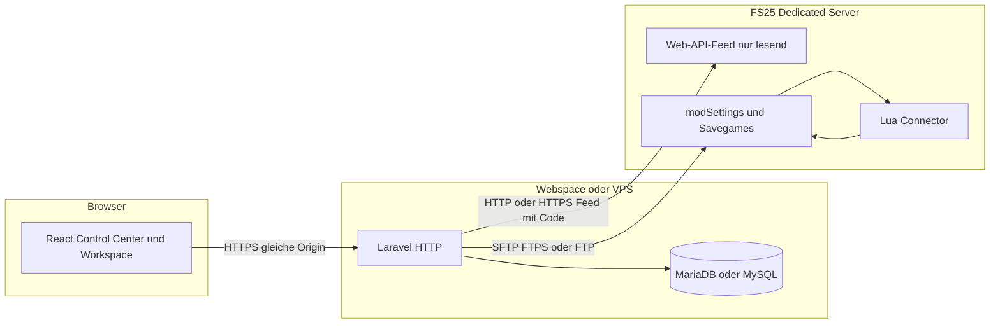
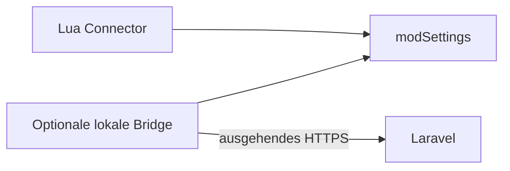

# Architektur

**Status:** Planung. Nicht implementiert.  
**Stand:** 12. Oktober 2026  
**Arbeitstitel:** FS25 Management Platform

## 1. Antwort auf die Kernfrage

Eine moderne FS25-Managementplattform, deren Dashboard auf Shared Hosting **und** auf eigener Infrastruktur läuft, wird als **ein modularer PHP-Monolith** gebaut. Der Browser lädt ein statisch gebautes Frontend. Das Backend beantwortet gewöhnliche HTTP-Anfragen und speichert den Zustand in MariaDB oder MySQL. Es gibt keine verpflichtenden Hintergrunddienste.

Der Connector auf einem gemieteten FS25-Server ohne Root wird als **gewöhnlicher Lua-Mod** geliefert. Er schreibt und liest Dateien im Spielprofil. Das Dashboard holt diese Dateien über den Dateizugang des Spielhosters ab und legt Aufträge dort ab. Dafür ist keine eingehende Portfreigabe am Spielserver nötig. Eine lokale Bridge ist die komfortablere Variante, wenn auf dem Spielrechner ein eigenes Programm laufen darf. Ausgehendes HTTPS direkt aus Lua wird erst ein Transport, wenn eine Engine-Funktion dafür nachgewiesen ist.

Spielwerte in der Produktivansicht stammen aus diesen Übertragungen. Fehlende Werte bleiben „nicht verfügbar“. Eine Spielaktion gilt erst nach einer Connector-Bestätigung mit derselben Auftrags-ID.

## 2. Zustand des Repository

**Fakt:** Am 12. Oktober 2026 war das Arbeitsverzeichnis leer und ohne Git. Diese Dokumente sind der erste Inhalt.

## 3. Warum dieser Stack

### 3.1 Verbindliche Randbedingungen

- Shared Hosting muss ohne Root, ohne Docker und ohne dauerhaften Node-Prozess funktionieren. Docker ist keine unterstützte Betriebsart.
- Cron ist nicht überall vorhanden. Bei STRATO ist Cron auf der neuen Plattform laut Anbieter-FAQ nicht verfügbar ([STRATO Cron](https://www.strato.de/faq/hosting/so-einfach-richten-sie-ihre-cron-jobs-ein/), abgerufen 12. Oktober 2026).
- MariaDB und MySQL müssen beide tragen.
- Der Spielserver darf keine eingehenden Ports für das Dashboard brauchen.
- Secrets, Sessions und Autorisierung liegen serverseitig.

### 3.2 Verglichene Backend-Optionen

| Option | Shared Hosting | MariaDB und MySQL | Wartbarkeit | Entscheidung |
| --- | --- | --- | --- | --- |
| Node.js-Server (Express, Nest, Fastify) | Dauerprozess ist auf klassischem Webspace in der Regel nicht betreibbar | Über Treiber möglich | Gut | Als Pflichtstack ausgeschieden. Optionaler Self-Host-Modus würde den Webspace-Weg zur Sonderlösung machen |
| Statisches Frontend plus serverlose Funktionen | Hängt am jeweiligen Anbieter | Möglich | Mittel | Kein portabler Shared-Hosting-Weg |
| Symfony 7/8 als Eigenbau der Anwendungsbasis | PHP-fähig | Über Doctrine möglich | Gut, mehr Grundgerüst selbst zu bauen | Zurückgestellt. Die Sicherheitsbausteine müssten einzeln zusammengesetzt werden |
| Schlankes PHP (Slim, eigene Kernel) | Sehr gut geeignet | Über Doctrine DBAL oder PDO möglich | Mehr eigener Code für Auth, Sessions, Validierung, i18n und Migrationen | Für ein einzelnes API-Gateway denkbar, für dieses Produkt zu wenig mitgelieferte Disziplin |
| Laravel 13 auf PHP 8.3–8.5 | Läuft als gewöhnliche PHP-Anwendung, wenn `public/` das Webroot ist und `vendor/` im Release-Paket liegt | First-Party-Treiber `mysql` und `mariadb` ([Laravel Database](https://laravel.com/docs/13.x/database)) | Auth, Sessions, Validierung, Queues auf Datenbank, Rate-Limits, i18n, Migrationen, Tests | **Gewählt** |

Laravel 13 ist am 17. März 2026 erschienen, verlangt PHP 8.3 bis 8.5 und erhält Security-Fixes bis 17. März 2028 ([Laravel Releases](https://laravel.com/docs/13.x/releases)). Laravel 12 unterstützt noch PHP 8.2, ist seit August 2026 aber nur noch im Security-Fenster. Ein neues Projekt auf 8.2 aufzusetzen wäre ein kurzer Support-Horizont.

**Annahme:** Aktuelle Shared-Hosting-Pakete, die PHP 8.3, 8.4 oder 8.5 im Kundenlogin anbieten, können diese Anwendung bedienen. Belegt ist das für STRATO, dort sind PHP 8.2, 8.3, 8.4 und 8.5 wählbar ([STRATO PHP](https://www.strato.de/faq/hosting/wie-aendere-ich-meine-php-einstellungen-im-hosting-paket/)). Andere Hoster sind einzeln noch nicht geprüft. PHP 8.2 reicht für Laravel 13 nicht.

### 3.3 Frontend

React und TypeScript werden mit Vite **im Release gebaut**. Auf dem Webspace liegt nur das Ergebnis unter `public/build`. Der Betreiber installiert dafür kein Node.js.

Die Oberfläche spricht dieselbe Origin wie das Backend an. Sitzungen laufen über Cookies. Ein getrenntes Token im Browser-Speicher ist für die Weboberfläche nicht vorgesehen.

Für Phase 2 entsteht zuerst ein Prototyp mit gekennzeichneten Demo-Daten und noch ohne dieses Backend. Die Designregeln stehen in [UX.md](UX.md). Nalika ist die Strukturreferenz (Sidebar, Kopfzeile, Inhaltsfläche, Karten). Code und Assets aus [puikinsh/nalika](https://github.com/puikinsh/nalika) werden nicht übernommen: eine LICENSE-Datei war unter dem üblichen Raw-Pfad nicht abrufbar, der Changelog vom 13. Februar 2026 beschreibt ein umgeschriebenes Colorlib-Template. Ohne gesichtete Lizenzdatei wird das Designsystem eigenständig nachgebaut.

### 3.4 Was bewusst nicht zur Pflicht wird

| Komponente | Rolle |
| --- | --- |
| Redis, Memcached | Optional später. Version 1 nutzt Datenbank-Cache und Datenbank-Sessions |
| WebSockets, Laravel Reverb, Echo | Optional im Self-Hosting. Shared Hosting nutzt begrenztes Polling |
| Queue-Worker, Horizon | Kein Dauerprozess. Aufträge, die der nächste HTTP-Request oder ein optionaler Cron ausführen kann, reichen für Kopplung und Abgleich |
| Elasticsearch, Objektstorage | Nicht erforderlich |
| Microservices | Die Grenzen sind Module in einem Prozess, keine eigenen Deployments |

## 4. Laufzeitbild



Der Feed ist die eingebaute, nur lesende Web-API des Dedicated Servers. Sie liefert Serverstatus, Kartenbild, Fahrzeugpositionen, Feld- und Farmland-Punkte, Mods, Savegame-Fahrzeuge und Wirtschaftsdaten. Der Mod bleibt nötig für Daten, die der Feed nicht enthält, und für bestätigte Spielaktionen. Einzelheiten der Probe stehen in [FS25-INTEGRATION.md](FS25-INTEGRATION.md).

Es gibt einen zweiten, einfacheren Pfad, wenn der Spielrechner ein eigenes Programm erlaubt:



Die Bridge läuft beim Kunden, nicht zwingend auf dem Webspace. Shared Hosting bleibt dadurch frei von einem Dauerprozess.

### 4.1 Taktung

- Der Mod tastet Spielobjekte in konfigurierbaren Intervallen ab, nicht in jedem Frame.
- Fahrzeuge können häufiger laufen als Felder, Tiere und Preise.
- Übertragen werden Änderungen und ein periodischer Vollabgleich, kein dauerhaftes Abbild jedes Objekts bei jedem Takt.
- Das Dashboard pollt nur, solange ein Workspace geöffnet ist, plus eine manuelle Aktion „Verbindung prüfen“.
- Ohne Cron läuft Aufräumen beim nächsten authentifizierten Request mit einer Sperre, damit nicht jeder Seitenaufruf dieselbe Arbeit macht.

Zielintervalle für die erste echte Kopplung, noch nicht gemessen: Zustand alle 15–60 Sekunden, Positionsdaten nur bei geöffneter Karte und nicht unter 5 Sekunden. Provider-Limits können das verlangsamen.

## 5. Modulgrenzen

Ein Laravel-Modul je Fachgebiet, jeweils mit eigenen Routen, Policies und Tests:

| Modul | Verantwortung |
| --- | --- |
| `Install` | Erstinstallation, Sperre danach |
| `Identity` | Benutzer, Sitzungen, globale Rolle |
| `Realm` | eine Installation, globale Einstellungen, Audit |
| `Workspaces` | Instanz, Mitgliedschaft, Kartenstatus |
| `Pairing` | einmaliger Kopplungscode, Connector-Identität, Rotation |
| `HostAccess` | Feed-URL und Code, optional Dateizugang, beides verschlüsselt |
| `Sync` | Snapshots annehmen, validieren, veralten |
| `Farms` | Ingame-Höfe, getrennt von Workspaces |
| `World` | Felder, Fahrzeuge, Tiere, Lager, Preise, Karte |
| `Finance` | beobachtete Spielkonten und Plattform-Rechnungen |
| `Payments` | Auftragszustand, Idempotenz, nur mit Connector-Bestätigung |
| `I18n` | Locale am Benutzer, Übersetzungsdateien |
| `Audit` | sicherheitsrelevante Ereignisse |

Die Modulnamen sind der geplante Schnitt. Ein Plugin-Marktplatz gehört nicht dazu. Siehe [PLUGIN-ARCHITECTURE.md](PLUGIN-ARCHITECTURE.md).

Öffentliche API-Pfade sind versioniert: `/api/v1/...`. Connector-Pfade liegen daneben unter `/api/v1/connector/...` und nutzen eine andere Authentifizierung als der Browser.

## 6. Autorisierung

Jede fachliche Abfrage trägt serverseitig `workspace_id` aus der aufgelösten Mitgliedschaft. Die vom Browser gesendete ID wird gegen `workspace_memberships` geprüft. Ein Realm-Administrator darf Workspaces der eigenen Installation öffnen; das ist eine explizite globale Berechtigung, kein stiller Fallback.

Ingame-Höfe hängen an einem Workspace. Eine Hof-ID aus dem Spiel ist weltweit nicht eindeutig und ersetzt keine Berechtigung.

Rechnungsaktionen binden zusätzlich Workspace, ausstellenden Hof, empfangenden Hof und Connector. Fehlt eine dieser Bindungen, wird der Auftrag nicht angelegt.

## 7. Konfiguration und Name

`APP_NAME` ist der Anzeigename. Der Installer fragt ihn ab. Standardvorschlag: „FS25 Management Platform“.

Geheimnisse liegen in `.env` außerhalb des Webroots, soweit der Hoster das erlaubt. Ist nur ein Webroot möglich, bleiben `.env`, `vendor/`, `storage/` und `app/` durch Webserver-Regeln unerreichbar. Der Installer prüft das mit einem HTTP-Zugriff auf eine absichtlich verbotene Testdatei und bricht bei einem Treffer ab. Details: [SHARED-HOSTING.md](SHARED-HOSTING.md).

## 8. Verzeichnisplan

Geplant, noch nicht angelegt:

```text
.
├── app/
│   ├── Modules/
│   │   ├── Install/
│   │   ├── Identity/
│   │   ├── Realm/
│   │   ├── Workspaces/
│   │   ├── Pairing/
│   │   ├── HostAccess/
│   │   ├── Sync/
│   │   ├── Farms/
│   │   ├── World/
│   │   ├── Finance/
│   │   ├── Payments/
│   │   └── Audit/
│   └── Support/
├── bootstrap/
├── config/
├── database/
│   └── migrations/
├── docs/
├── public/                      # einziges Webroot
│   ├── index.php
│   └── build/                   # Vite-Ausgabe
├── resources/
│   ├── js/                      # React, Design-Tokens, Seiten
│   └── lang/                    # de, en
├── routes/
│   ├── web.php
│   └── api.php
├── connector/                   # FS25-Mod-Quellen, ohne Geheimnisse
├── bridge/                      # optionales lokales Programm
├── (kein docker/)               # Docker bewusst nicht unterstützt
├── tests/
│   ├── Unit/
│   ├── Feature/
│   └── Database/                # MariaDB- und MySQL-Läufe
├── CHANGELOG.md
└── README.md
```

Release-Artefakte, später aus CI:

- `fs25-platform-<version>-web.zip` mit `vendor/` und gebautem Frontend, ohne Node und ohne Composer-Pflicht auf dem Zielsystem.
- `FS25_Connector-<version>.zip` mit `modDesc.xml` an der Wurzel des Archivs. Ohne Passwörter, ohne FTP-Daten, ohne API-Tokens.

## 9. Design in der Architektur

Phase 2 baut die Oberfläche vor den Fachmodulen. Control Center und Workspace teilen Sidebar, Header, Tokens und Icons, unterscheiden sich aber im Kontextstreifen: im Workspace bleiben Instanzname, Verbindungsstatus, letzte Synchronisation und der Weg zurück ins Control Center sichtbar.

Demo-Daten sind erlaubt, bis ein Connector liefert, und tragen eine sichtbare Demo-Kennzeichnung. Siehe [UX.md](UX.md).

## 10. Tests als Teil der Architektur

Die Trennung der Workspaces ist nur dann glaubwürdig, wenn Feature-Tests einen fremden Workspace mit einer gültigen Sitzung eines anderen Mitglieds aufrufen und 404 oder 403 erhalten. Dieselbe Prüfung gilt für Höfe, Rechnungen und Connector-Aufträge.

Migrationen laufen in CI gegen einen MySQL- und einen MariaDB-Dienst. Der Anwendungscode nutzt den passenden Laravel-Treiber (`mysql` oder `mariadb`), nicht einen Treiber für beide Server.

## 11. Folgen für spätere Phasen

- Phase 2 braucht dieses Backend noch nicht.
- Phase 3 setzt Projekt, Migrationen, Installer, Sitzungen und das Designsystem um.
- Phase 4 beginnt mit dem nur lesenden Web-API-Feed: Erreichbarkeit, Spielversion, Spielerzahl, Karte, Fahrzeugpositionen. Hofkonten und Spielaktionen bleiben aus, bis sie der Feed oder der Mod wirklich liefern.
- Phase 5 schaltet Zahlungen erst frei, wenn ein Dedicated-Server-Versuch die Geldbewegung im Savegame bestätigt.

## 12. Risiken, die die Architektur tragen muss

1. **Lua hat keinen belegten HTTPS-Client.** Der Web-API-Feed ersetzt das für alles, was er wirklich ausliefert. Alles andere läuft über Dateien unter `modSettings` und im Savegame.
2. **`modSettings` gilt als üblicher FTP-Bestandteil.** Der Betreiber beschreibt den Normalfall so: der Hoster gibt den FS-Ordner unter My Games frei, mindestens Mods, Savegames und `modSettings`. Pfade unterscheiden sich. Die Einrichtung prüft den konkreten Pfad, statt ihn zu raten.
3. **Der Feed-Code ist ein Leserecht auf Spielpositionen, Mods und Savegame-Auszüge.** Das Backend holt den Feed. Der Browser bekommt den Code nicht. Klartext-HTTP verlangt dieselbe ausdrückliche Bestätigung wie unverschlüsseltes FTP.
4. **Laravel auf Shared Hosting ist empfindlich bei `putenv`, `symlink` und dem Document Root.** Der Installer muss diese drei Punkte messen und einen geführten Fallback haben. Siehe [SHARED-HOSTING.md](SHARED-HOSTING.md).
5. **Geldtransaktionen sind nur als vorhandene Funktionsnamen belegt, nicht als sicherer Auftragsweg.** Der Feed enthält keinen belastbaren Kontostand je Hof. Bis zu einem eigenen Nachweis bleiben Rechnungen Plattformdokumente mit dem Status, dass die Spielausführung nicht verfügbar ist.
