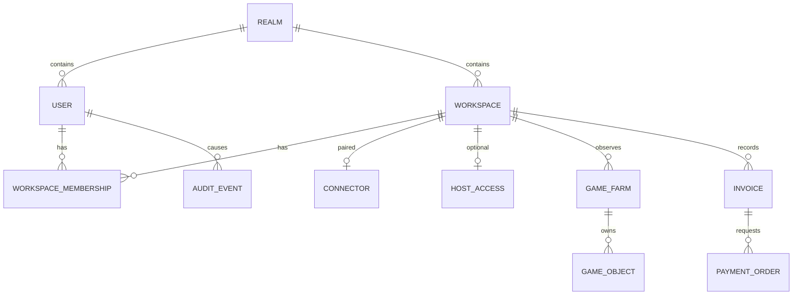

# Datenmodell

**Status:** Skizze. Keine Migrationen.  
**Stand:** 12. Oktober 2026

Begriffe in der Datenbank bleiben Englisch. Die Oberfläche übersetzt sie.

## 1. Getrennte Identitäten

Diese IDs dürfen nicht ineinander übergehen:

| Begriff | Bedeutung | Eindeutigkeit |
| --- | --- | --- |
| Realm | eine Installation dieser Plattform | eine Zeile je Installation in Version 1 |
| User | zentraler Account | global in der Installation |
| Workspace | ein registrierter FS25-Gameserver bzw. dessen Spielstand | öffentliche UUID |
| WorkspaceMembership | Benutzer plus Rolle in genau einem Workspace | Paar aus User und Workspace |
| GameFarm | Hof im Spielstand | `game_farm_id` nur innerhalb des Workspace |
| Connector | authentifizierte Spielkomponente | genau einer je Workspace |
| GameObject | Fahrzeug, Feld, Tierhaltung, Lager, Preis, Beobachtung | Schlüssel aus Workspace und spielseitiger ID |
| Invoice | Plattform-Rechnung | Nummer je Workspace |
| PaymentOrder | idempotenter Spielauftrag | UUID, unabhängig vom Rechnungsstatus |

Ein Benutzer wird einmal angelegt. Workspaces speichern nur die Mitgliedschaft.

Version 1 modelliert genau einen Realm pro Installation. Die Tabelle existiert trotzdem, damit eine spätere Mehrmandanten-Instanz keine Umbenennung aller Tabellen braucht. Ob mehrere Realms je Datenbank je kommen, ist offen und kein Version-1-Ziel.

## 2. Beziehungen



`GAME_OBJECT` ist in der Skizze der Oberbegriff. Gespeichert wird er in fachlichen Tabellen, nicht in einer einzigen untypisierten Tabelle.

## 3. Tabellen

Spaltentypen sind die Absicht für Migrationen. Beide Datenbanken bekommen dieselben logischen Typen. JSON wird als Dokument gespeichert; Filter laufen über normale Spalten. MySQL-spezifisches `JSON_TABLE` und MariaDB-Vector sind nicht Teil des Modells.

Gemeinsame Konventionen:

- interne Schlüssel: `bigint` ohne Vorzeichen, automatisch
- öffentliche IDs in URLs: UUID, wo Aufzählung sonst Daten verraten würde
- Zeitpunkte: UTC in `timestamp`
- Geld in der Plattform: Ganzzahl in der kleinsten Währungseinheit des Spiels, plus `currency_code`, der aus dem Spiel beobachtet wird, falls vorhanden
- Zeichensatz: `utf8mb4`, Kollation `utf8mb4_unicode_ci`

### 3.1 `realms`

| Spalte | Zweck |
| --- | --- |
| id, public_id | interne und öffentliche ID |
| display_name | vom Installer gesetzt, änderbar |
| locale_default | `de` oder `en` |
| settings | nicht geheime Anzeigeoptionen |

### 3.2 `users`

| Spalte | Zweck |
| --- | --- |
| id, public_id | |
| realm_id | |
| email | eindeutig je Realm, normalisiert kleingeschrieben |
| name | |
| password_hash | `password_hash`, nie Klartext |
| locale | `de` oder `en`, Fallback Realm-Standard, dann `en` |
| timezone | IANA-Name |
| global_role | `member` oder `realm_admin` |
| is_active | Deaktivierung statt Löschen, solange Audit das Konto braucht |
| last_login_at | |

Passwort-Reset-Tokens liegen in einer eigenen Tabelle, nur als Hash, mit Ablauf.

### 3.3 `workspaces`

| Spalte | Zweck |
| --- | --- |
| id, public_id | |
| realm_id | |
| display_name | Kartenname |
| icon_path | optional, vom Betreiber hochgeladen, kein Remote-URL-Zwang |
| lifecycle | `active` oder `disabled` |
| map_name, save_slot, game_version | nur wenn gemeldet, sonst leer |
| link_state | `unpaired`, `paired`, `online`, `offline`, `error`, `unknown` |
| connector_version | gemeldete Mod-Version |
| last_seen_at, last_sync_at | |
| data_mode | `live`, `demo`, `empty` |
| status_note | kurze Warnung, zum Beispiel fehlende Kopplung |

`data_mode = demo` ist nur für den Prototyp und für ausdrücklich markierte Testdaten. Produktivabfragen mischen keine Demozeilen in Live-Workspaces.

### 3.4 `workspace_memberships`

| Spalte | Zweck |
| --- | --- |
| workspace_id, user_id | eindeutig zusammen |
| role | `workspace_admin`, `manager`, `operator`, `viewer` |

Ein Realm-Admin braucht keine Mitgliedschaft, um einen Workspace zu öffnen. Alle anderen brauchen eine Zeile. Die Policy prüft beides serverseitig.

Rollenrechte, geplant:

| Fähigkeit | viewer | operator | manager | workspace_admin |
| --- | --- | --- | --- | --- |
| Lesen | ja | ja | ja | ja |
| Rechnungen anlegen | | ja | ja | ja |
| Zahlung anstoßen | | | ja | ja |
| Mitglieder pflegen | | | | ja |
| Connector koppeln, Host-Zugang | | | | ja |
| Workspace deaktivieren | | | | ja |

Die Matrix wird in Code und Tests festgehalten, nicht nur in dieser Tabelle.

### 3.5 `connectors`

| Spalte | Zweck |
| --- | --- |
| workspace_id | eindeutig |
| transport | `file_pull`, `local_bridge`, später eventuell `lua_https` |
| credential_hash | Hash des Connector-Geheimnisses, falls der Transport eines hat |
| pairing_code_hash, pairing_expires_at | einmaliger Code, danach geleert |
| paired_at, rotated_at | |
| last_error | gekürzt, ohne Geheimnisse |

### 3.6 `host_accesses`

Nur wenn der Betreiber einen Dateiabruf ausdrücklich einrichtet.

| Spalte | Zweck |
| --- | --- |
| workspace_id | |
| protocol | `webapi`, `sftp`, `ftps`, `ftp`, `nitrado_api`, `manual` |
| base_url | beim Feed die Server-URL ohne Code, je Workspace verschieden |
| host, port, username | für Dateizugang; beim Feed kann die URL das schon enthalten |
| secret_ciphertext | Feed-Code oder Dateipasswort, mit dem Anwendungsschlüssel verschlüsselt |
| remote_mod_path, remote_state_path | erwartete Ordner `mods`, `savegame` und `modSettings`, nach dem List-Versuch gespeichert |
| insecure_acknowledged_at | Pflicht bei `ftp` und bei einem Feed über klares HTTP |
| last_verified_at, last_error | |

Die Oberfläche zeigt das Geheimnis nach dem Speichern nicht erneut an. Rotation ersetzt den Ciphertext.

FTP-Zugangsdaten stehen nie im Mod-ZIP.

### 3.7 `game_farms`

| Spalte | Zweck |
| --- | --- |
| workspace_id | |
| game_farm_id | Integer aus dem Spiel |
| name | falls gemeldet |
| balance_minor, equity_minor | nur mit `observed_at` |
| observed_at | |
| is_present | false, wenn der Hof in einem neueren Snapshot fehlt |

Eindeutig: `(workspace_id, game_farm_id)`.

### 3.8 Welt-Tabellen

Dieselbe Form für `vehicles`, `fields`, `animal_holdings`, `storages`, `productions`, `price_quotes`:

| Spalte | Zweck |
| --- | --- |
| workspace_id | |
| game_farm_id | leer, wenn das Objekt nicht hofgebunden ist, etwa öffentliche Preise |
| game_object_id | stabile ID aus dem Spiel, sobald bekannt |
| name, category | für Listen und Filter |
| state | fachliche Spalten, die wir wirklich anzeigen |
| unknown_fields | nichts; fehlende Eigenschaften bleiben NULL und heißen in der UI „nicht verfügbar“ |
| payload | Rohsnapshot für Diagnose, nicht als alleinige Quelle der Anzeige |
| observed_at | |
| content_hash | um unveränderte Objekte nicht neu zu schreiben |

Geometrie von Feldern: eine Spalte `geometry` mit einem einfachen Polygon im Spielkoordinatensystem, nur wenn der Connector Punkte liefert. Ohne Punkte gibt es keine Rechteck-Attrappe in der Produktivkarte.

Positionen von Fahrzeugen: `pos_x`, `pos_y`, `pos_z`, `heading`, nur mit Zeitstempel. Die Karte markiert Daten als veraltet, wenn `observed_at` älter als der konfigurierte Schwellwert ist.

### 3.9 `sync_batches`

Ein Batch ist eine Lieferung des Connectors.

| Spalte | Zweck |
| --- | --- |
| workspace_id, connector_id | |
| batch_uuid | Idempotenz |
| captured_at | Spielzeitpunkt |
| received_at | Serverzeit |
| kind | `hello`, `full`, `delta` |
| status | `accepted`, `rejected` |
| reject_reason | Validierung, ohne Rohdaten von Geheimnissen |

Ein erneut gesendeter `batch_uuid` verändert keine Zeilen ein zweites Mal.

### 3.10 Rechnungen und Zahlungen

`invoices`

| Spalte | Zweck |
| --- | --- |
| workspace_id | |
| public_id, number | Nummer eindeutig je Workspace |
| issuer_game_farm_id, recipient_game_farm_id | beide müssen im selben Workspace existieren |
| status | siehe Zustände unten |
| issued_at, due_at, cancelled_at | |
| total_minor | aus Positionen berechnet und gespeichert |

`invoice_lines`: Position, Beschreibung, Menge, Einzelbetrag.

`invoice_events`: jede Statusänderung mit Akteur, Zeitpunkt und Grund. Die Historie wird ergänzt, nicht überschrieben.

`payment_orders`

| Spalte | Zweck |
| --- | --- |
| id UUID | die ID, die der Connector zurückmelden muss |
| invoice_id, workspace_id | |
| idempotency_key | eindeutig je Workspace |
| amount_minor | |
| state | `queued`, `dispatched`, `confirmed`, `unknown`, `failed` |
| dispatched_at, confirmed_at | |
| game_reference | vom Connector, leer bis zur Bestätigung |
| balance_before, balance_after | beobachtet, falls geliefert |

Zustände der Rechnung:

```text
draft → issued → payment_pending → paid
  │         │            │
  │         │            └→ payment_unknown → paid
  │         │                     └→ payment_failed
  │         └→ cancelled
  └→ cancelled
```

`paid` entsteht nur aus `payment_orders.state = confirmed`. Ein Timeout setzt `payment_unknown`. Er setzt nicht `payment_failed` und nicht `paid`.

Solange die Spieltransaktion nicht auf einem Dedicated Server nachgewiesen ist, kennt die Rechnung zusätzlich den Ausführungsmodus `platform_only`. In diesem Modus gibt es keinen Übergang nach `payment_pending`. Die Oberfläche sagt, dass die Spielausführung nicht verfügbar ist.

## 4. Indizes

Pflicht, sobald die Tabellen entstehen:

- Mitgliedschaft: `(user_id, workspace_id)` eindeutig
- jede Welt-Tabelle: `(workspace_id, game_object_id)` eindeutig und `(workspace_id, observed_at)`
- Rechnungen: `(workspace_id, number)` eindeutig, `(workspace_id, status, due_at)`
- Zahlungsaufträge: `(workspace_id, idempotency_key)` eindeutig
- Audit: `(realm_id, created_at)`, `(workspace_id, created_at)`

Listenendpunkte filtern, sortieren und paginieren in der Datenbank.

## 5. Aufbewahrung

Rohpayloads können größer werden als die Anzeigetabellen. Geplant ist, Payloads älter als 30 Tage zu kürzen und die fachlichen Spalten zu behalten. Der Zeitraum wird konfigurierbar. Ohne Cron erledigt das ein seltener, gesperrter Lauf beim Request.

## 6. Was dieses Modell nicht tut

- Es legt Benutzer nicht je Workspace neu an.
- Es behandelt die Workspace-UUID nicht als Berechtigung.
- Es speichert keine erfundenen Kontostände.
- Es schreibt Host-Passwörter nicht in den Connector und nicht ins Audit.
